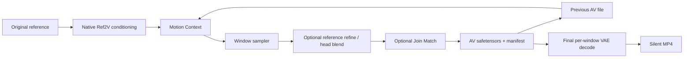
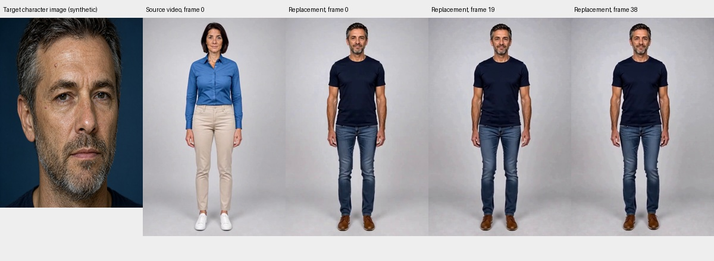
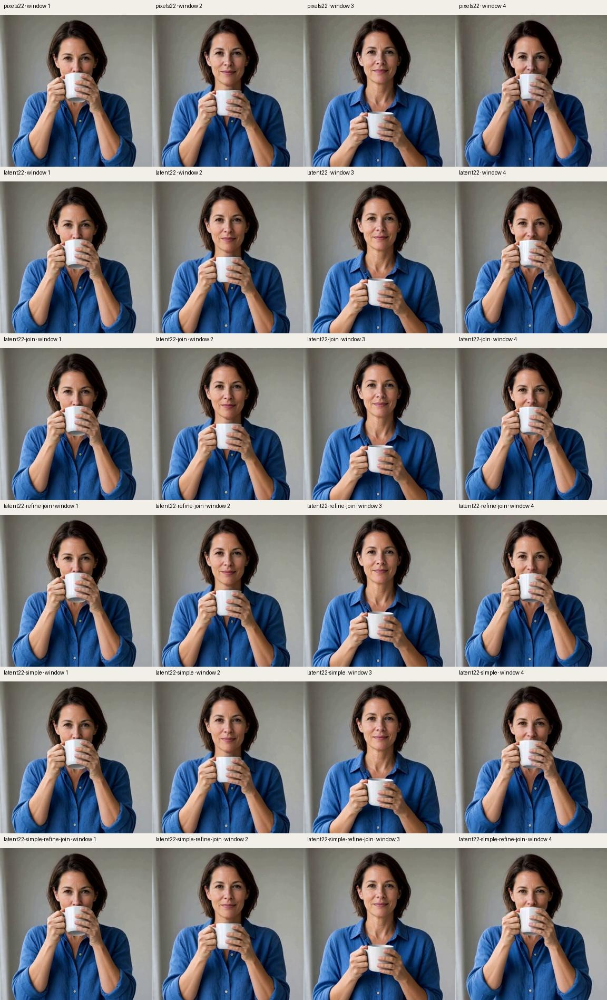
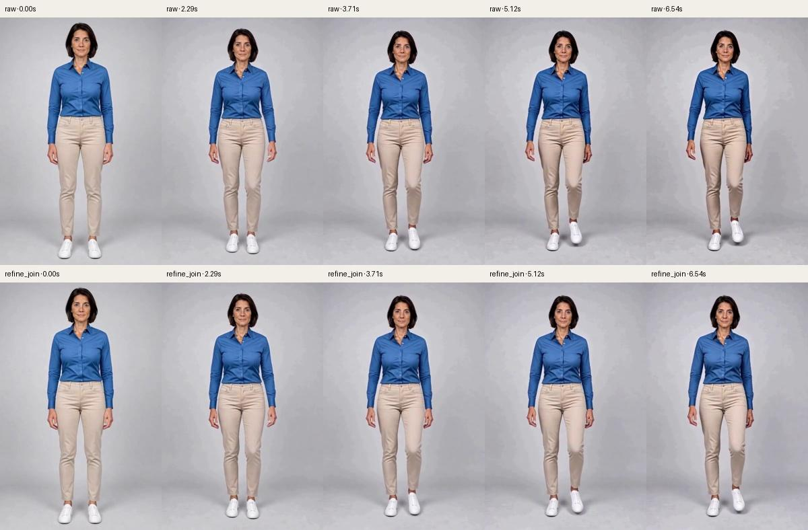
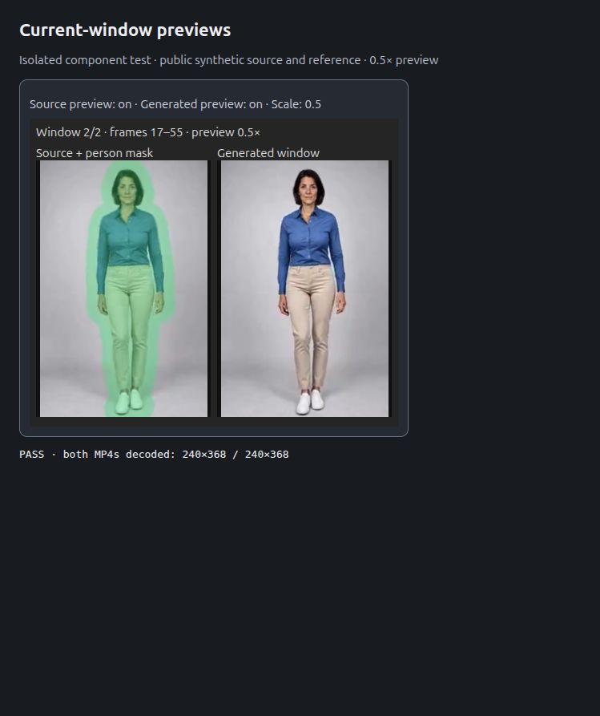

# ComfyUI H3 Texture Lab

[English](README.md) · [简体中文](README.zh-CN.md) · [Experiment report](docs/EXPERIMENTS.md)

**Character Swap from one source video and one character image**, with experimental MiniMax H3 latent continuation, disk-backed windows, and texture/color-drift investigations.

## Origin and attribution

This project started as an adaptation of **Character Swap V1.5 · H3 Relay 2.0** by **Akatz AI / Akatz Labs**:

- [Original Character Swap V1.5 model and workflow](https://huggingface.co/akatz-ai/MiniMax-H3-Character-Swap-LoRA)
- [Exact original Relay V2 workflow](https://huggingface.co/akatz-ai/MiniMax-H3-Character-Swap-LoRA/blob/main/examples/H3-Character-Swap-Relay-V2.json)
- [H3 Relay toolkit](https://github.com/akatz-ai/h3-relay)

The initial investigation adapted its windowed workflow to save completed latents instead of accumulating decoded image prefixes. This repository extracts the continuation/storage experiments into a standalone node pack. **Character Swap V1.5, its training, the original workflow, and H3 Relay are upstream work.** The new Character Swap examples adapt its source-video, SAM mask, reference-image and source-audio pipeline. Separate single-image Ref2V examples remain component experiments; their results must not be read as Character Swap quality measurements.

Native latent continuation, Refine Blend, and Join Match are provided by [NikoDemon80/ComfyUI-H3-Motion-Context](https://github.com/NikoDemon80/ComfyUI-H3-Motion-Context). This pack calls those nodes and adds window planning, disk state, streaming final decode, and reproducible experiments. See [provenance and licenses](THIRD_PARTY_NOTICES.md).

## What is implemented

- Carry aligned **22-frame native AV latent context** between windows, preserving the original image reference.
- Save one AV safetensors file per window and a manifest; keep decoded images out of accumulated loop state.
- Decode one window at a time during final video export.
- Optional upstream **Join Match** and **one-step Refine Blend** with the pinned head protected.
- A matched `pixels_reencoded` diagnostic that changes video history only, retaining the same audio context.
- An opt-in native weight-offload policy for small GPUs.
- Experimental FFN chunks and fused modulation, both disabled by default.

These methods reduce some observed drift. They do **not** guarantee stable identity, texture, anatomy, or moving-camera backgrounds over arbitrary durations.

## Install

Tested with **ComfyUI 0.42.0**, Python 3.12, PyTorch 2.15.0+cu132, Linux, RTX 3070 Ti and RTX A2000 Laptop. Native H3 support and the upstream Motion Context layout contract are required.

Inside `ComfyUI/custom_nodes`:

```sh
git clone https://github.com/akatz-ai/h3-relay.git
git clone https://github.com/NikoDemon80/ComfyUI-H3-Motion-Context.git
git clone https://github.com/YichengDuan/ComfyUI-H3-TextureLab.git
```

Use **ComfyUI's Python environment** to install this pack's `requirements.txt` if needed. Copy the PNGs and MP4s in `examples/inputs` to `ComfyUI/input`, then restart ComfyUI. Model filenames are listed in [configs/models.json](configs/models.json); obtain weights separately from their original publishers.

Import a workflow from [examples](examples). Start with:

| Use | Workflow |
|---|---|
| **Video + character image, 480 preset** | **`H3-TextureLab-CharacterSwap-480.json`** |
| **Video + character image, 768 preset** | **`H3-TextureLab-CharacterSwap-768.json`** |
| Video + image, RAM cache | `H3-TextureLab-CharacterSwap-480-RAM.json` / `...768-RAM.json` |
| Video + image, optional cache cleanup | `H3-TextureLab-CharacterSwap-480-CacheCleanup.json` / `...768-CacheCleanup.json` |
| Single-image component: native latent carry | `H3-TextureLab-Simple.json` |
| Reference refresh + join correction | `H3-TextureLab-Simple-Refine.json` |
| Full-body motion, 480-pixel short edge | `H3-TextureLab-Motion-480-Refine.json` |
| Full-body motion, 768-pixel short edge | `H3-TextureLab-Motion-768-Refine.json` |

The **single-image component examples** generate **158 frames / 6.58 seconds** at 24fps. Defaults: 56-frame windows, 22-frame context, CFG 1, 8-step Ref2V Turbo, `er_sde`, and the selected `normal` or `simple` scheduler. Seeds are fixed. Adjust the reference, prompt, and `total_frames` for your own experiment.

`56 + 3 × (56 − 22) = 158`: pinned context is trimmed from every continuation. Use the window planner's iteration count; avoid hard-coding the number of loop iterations.

## Character Swap usage

Load a source video and a portrait or character image. Describe the source person in the SAM text (default `person`), inspect the selected mask, and describe the replacement character in the H3 prompt. The new workflows retain the source soundtrack. They use the original **Character Swap V1.5 + FL2V Turbo 8-step**, both strength 1, `er_sde` / `normal`, CFG 1. They do not use the Ref2V Turbo adapter from the component examples.

The initial short test setting is **56 delivered frames / 2.33s**, 39-frame windows, 22-frame context, fixed seed 194731. Source preparation uses the upstream pixel-budget presets; actual dimensions depend on the input. For a longer video set Prepare Source `duration_seconds` to zero. The planner reads the prepared frame count automatically. FFN chunks are 2048 tokens for this small-GPU example; fused modulation is off.

Source pixels outside the pooled edit mask remain source latent samples. Native context is applied **without replacing that source latent or its noise mask**. The first frame is not pinned to the portrait composition. Source audio is guided separately and muxed into final output. Global Join Match is **off** because it would modify protected background samples.

## Single-image component pipeline



Refinement uses the main schedule's final interval, plain original-reference conditioning, a separate fixed seed, and the upstream blend node. It is skipped on the first window and in non-refine examples through lazy execution. The blend protects pinned frames. `normal` and `simple` produce different final sigmas; their refinement passes are not interchangeable.



[480 Character Swap](docs/media/character-swap-480.mp4) · [768 Character Swap](docs/media/character-swap-768.mp4) · [Distinct-identity control](docs/media/character-swap-male-control.mp4)

## Results and evidence

[Detailed experiments](docs/EXPERIMENTS.md) include successful and unsuccessful variants, parameters, window-level timing, memory definitions, and limitations. Machine-readable measurements are in [results](results).

- **Video + image Character Swap** completed at480×736 and768×1152, two windows /56frames each, on the3070Ti. A separate39-frame male portrait control visibly changed identity. These short tests do not qualify40s identity stability.
- A prior disk-latent/color experiment completed **40s, 960 frames, 768×768** without OOM. That used the earlier pixel-boundary/color-feedback recipe, not a 40s validation of the new Motion Context recipe.
- New static tests compare six recipes from the **same first sampled AV window**, four windows each, 480×480.
- New full-body movement tests cover **480×736** and **768×1152**, four windows and 158 delivered frames. All use a generated, fully clothed adult reference.
- FFN chunking reduced an isolated large FFN's extra allocations from 966 to 288 MiB; a real 768×768 window saved only about 141 MiB overall. No reliable whole-video speedup is established.
- Fused modulation changed BF16 rounding and showed no reliable end-to-end benefit. Keep it off while assessing texture drift.





[480p motion video](docs/media/motion-480-refine.mp4) · [768p motion video](docs/media/motion-768-refine.mp4)

## Disk or system-RAM cache

The **Store AV Latent · Disk / RAM** node has a **`cache_mode`** selector:

| Mode | Window cache | Intermediate assembled MP4 | Recovery |
|---|---|---|---|
| `disk` (existing/default) | Float32 AV safetensors and manifest in the output cache directory | On disk | Files remain available until cleanup |
| `ram` | Owned CPU tensors in this run's execution state | Encoded directly into an in-memory MP4 buffer, including source audio | Lost when released, the execution cache is cleared, or ComfyUI exits |

Use `H3-TextureLab-CharacterSwap-480-RAM.json` or `...768-RAM.json`, or set **`cache_mode=ram`** on the store node in your own copy. Finish Video detects the mode automatically. Existing workflows keep the disk default. Do not change the mode halfway through a run.

RAM mode writes no per-window latent files, manifest, temporary audio WAV or intermediate MP4 cache. **Saving the final video still writes the output MP4**, using an atomic temporary delivery file. With `cleanup_cache=true`, the verified-save node releases this run's owned RAM payloads and in-memory video buffer after saving; with it off, they remain available while the execution state is retained. This does not purge model caches or other runs. Native execution caches may retain additional tensors independently.

Memory use grows with resolution and window count: the measured 39-frame cache payload is about1.61MB at480×736 or4.00MB at768×1152 per window, roughly90MB/224MB for40s at24fps with22-frame overlap, **excluding** models, source frames/masks, decoded-window buffers, encoded video and native executor caches. RAM mode does not guarantee zero system-wide SSD writes: ComfyUI logs, kernel caches and operating-system swap may still write. It does not change swap settings, and it cannot recover a run after a crash/restart.

## SSD writes and cache cleanup

**In `disk` mode, disk-backed windows trade memory use for additional disk writes.** Each sampled window, including its overlapping context, is saved as uncompressed float32 video/audio safetensors in `<output directory>/H3-TextureLab-Cache/<run-id>/`. The manifest and assembled video also require writes; saving the delivered video can create another output file. Total writes therefore exceed the size of the final compressed MP4 and grow with resolution, duration, overlap and repeated runs.

If this output/cache directory is on an SSD, these writes contribute to SSD wear. This project has not measured long-term SSD endurance impact. Keep sufficient free space and consider the write workload when choosing the output drive; storage speed can also affect caching and export time.

**Caches are retained by default.** For optional automatic cleanup, use `H3TextureSaveVideo` ("Save Video & Optional Cache Cleanup") after `H3TextureFinishVideo`, connecting both the finished video and the same End Loop state. The new `H3-TextureLab-CharacterSwap-480-CacheCleanup.json` and `...768-CacheCleanup.json` examples include this node. Set its **`cleanup_cache`** switch to **true** to opt in; its default is **false**.

The node saves an MP4 outside the cache directory, decodes every saved video frame and audio stream, checks the frame count/canvas/frame rate and audio-stream presence, then deletes only that completed run's recognized cache files. It returns a video pointing to the saved delivery, so playback still works after cleanup. Save/verification failure or cancellation before cleanup preserves the cache. Unknown files, symlinks or a mismatched manifest cause cleanup to be skipped and reported. Other run directories and model caches are untouched.

Use this as the terminal save for that run. Keep cleanup disabled if another branch, continuation, recovery or later re-export still needs its cached latents or assembled video; success of this save does not certify unrelated workflow branches. Existing workflows are unchanged and can keep using standard Save Video without automatic cleanup. The examples retain native Start Loop execution so later runs build fresh cache state.

You can also manually remove a completed run's cache after verifying that its final video is stored outside that directory and no active work needs its files. Cleanup reclaims space; it does **not** undo SSD writes already performed.

## Important limits

- The exporter retains an optional **source soundtrack**. Single-image examples remain silent; generated audio-latent decoding is not implemented.
- Longer context consumes generated frames and adds conditioning work. A 40s request with these defaults requires more windows than a one-frame boundary recipe.
- Background metrics use a fixed neutral-background mask. They are not identity/anatomy/perceptual-quality scores. Lower high-frequency energy can also mean blur.
- Results cover a small number of generated references and seeds. Moving-camera and complex-scene generalization remains unqualified.
- FFN chunks can change full-model outputs slightly. Fused modulation changes numerical behavior more directly. Both are opt-in.
- `H3TextureLowVRAM` uses native sampler weight offloading. The nodes add no manual model-cache purge; native ComfyUI residency management still applies. Benchmark setup releases inactive encoders between conditioning and diffusion.
- The Python benchmark driver supports resuming saved progress. Automatic GUI recovery from a disk manifest is not implemented in this initial version.

## Reproduce

For the **video + image Character Swap** workflow, with the server already running and fixtures in its input folder:

```sh
python benchmarks/run_character_swap.py \
  --workflow examples/H3-TextureLab-CharacterSwap-480.api.json \
  --output /path/to/test-records
```

Use `--source` and `--reference` to select filenames already in the server input folder; `--duration 0` selects the full source. `configs/CharacterSwap-Male-Control.api.json` is the separate short distinct-identity sanity test.

The following command reproduces the **single-image movement component** tests:

Run with ComfyUI's Python and SageAttention installed for the recorded protocol:

```sh
CUDA_VISIBLE_DEVICES=0 python benchmarks/run_motion.py \
  --comfy-root /path/to/ComfyUI \
  --motion-context-root /path/to/ComfyUI/custom_nodes/ComfyUI-H3-Motion-Context \
  --output /path/to/experiment-output \
  --reference examples/inputs/H3_TextureLab_Body_Reference.png \
  --size 480 --modes raw refine_join
```

For 768×1152, use `--size 768 --modes refine_join`. Configuration, source hashes, saved AV windows, stage-level timing and progress are recorded in the output directory. Cached conditioning is local trusted PyTorch data; do not load untrusted `.pt` files.

```sh
python -m unittest discover -s tests -v
```

GUI/API examples were validated against native ComfyUI. Unit storage fixtures are synthetic and are clearly separated from actual H3 inference results.

## License

GPL-3.0-only for this source release. Upstream source and model weights retain their respective licenses. No model checkpoints, personal input media, credentials, or private user workflows are distributed.

## Zero-context independent windows

Set **`context_frames=0`** on **Window Plan** to generate independent windows. Source-video slices, masks and original reference conditioning are retained; Motion Context, previous-window latent loading and Join Match are skipped. All windows are still accumulated in the chosen disk/RAM cache and assembled in order, without discarding overlap. Existing workflows keep their context setting.

Character Swap examples already disable `first_frame_guide`. If that optional switch is enabled, the reference first-frame anchor is applied at the start of **every** independent window. Zero context may limit propagation of previous-window errors, but can cause abrupt pose, texture or color changes at joins; it is **not a proven color-drift fix**. With identical conditioning and a fixed seed, single-image Ref2V independent windows may repeat the same clip. CPU tests verify frame accounting and conditioning preservation; zero-context H3 image quality has not been evaluated.

## One-frame context

Set **`context_frames=1`** on Window Plan to pin the previous window's final decoded frame at frame 0 of the next window. Exactly one leading frame is trimmed at each join; the source-video/mask slices overlap by one frame, and original reference conditioning is retained. Disk and RAM storage both work. Existing workflow settings are unchanged.

**This mode needs a VAE round trip.** The last token of a normal H3 window spans four frames, so it cannot be relabeled as a one-frame raw latent. This mode decodes the previous window and re-encodes only its last frame through upstream Motion Context, regardless of `context_source`. Aligned 5/22/39/56-frame contexts retain their existing raw-latent behavior. If `carry_audio=true`, the existing 18-frame raw audio tail is retained with placement calculated from the original AV window. Character Swap keeps its existing `carry_audio=false` and source-audio guide.

One frame gives an appearance anchor, with less motion information than a longer context. It may show motion discontinuities and VAE reconstruction/color changes; it is not a proven color-drift fix. Validation uses the real upstream node and synthetic CPU VAE fixtures, not an H3 quality test.

## Streaming source and current-window previews

Use the new **`H3-TextureLab-CharacterSwap-480-Streaming-RAM.json`** or **`...768-Streaming-RAM.json`**. Existing workflows are unchanged. The native SAM3.1 multiplex tracker runs once over a bounded file-backed frame sequence, retaining its original temporal state. The preparation pass counts the exact 24fps timeline without building a full RGB tensor; tracking caches at most three decoded native-plane frames. Only binary masks are retained across the clip, packed to one bit per prepared-canvas pixel. Recovery and Euclidean expansion are computed a frame at a time. H3 reads/expands only its current source window, with exact overlap and last-frame/audio padding.

Video is decoded, resized and losslessly piped through FFmpeg/FFV1 to PyAV, preserving the same float/chroma conversion as the original Relay preparation. There is **no prepared-video cache file**. Decoding is sequential in normal loop order; revisiting an evicted earlier window reopens the decoder and reads its prefix again. Cancellation during reads/tracking and final-window completion close the reader; idle readers retained during sampling close when their cached state is released. File changes during a run are rejected. Source counts exclude the artificial tail frames that the original preparation pads before SAM tracking.

The **Current Window Previews · RAM** node shows both **source + person mask** and **generated result**, at **0.5× width and height** by default. It is placed inside the loop and passes the sampled AV latent through unchanged. Both streams show only newly delivered frames, excluding the carried overlap. Previews are compressed MP4 bytes served from RAM with HTTP range support; only the latest window is retained, capped at64MiB. These previews do not add intermediate MP4 writes. **Generated preview adds a VAE decode of the current full-resolution latent before resizing**; it can be disabled independently to avoid that extra work. Final output resolution and stored latents are unchanged. Old preview URLs expire when the next window replaces them or the server exits.

Limits: streaming currently requires Linux/POSIX, FFmpeg/FFprobe and a plain untrimmed file-backed **Load Video** input. Use `duration_seconds` in the preparation node for a prefix trim; cropped/trimmed or in-memory VIDEO wrappers are rejected instead of silently ignoring edits. Source audio remains a CPU waveform, and compact masks still grow with clip length. Current-window RGB/mask tensors and model/executor caches still consume RAM. This is not a hard total-RAM limit. Detection stays on GPU; mask packing/expansion and video decoding use CPU. With a single initialized object at `max_objects=1`, the installed tracker already skips new-object detection while the cap is reached, so increasing `detect_interval` may have no tracking-speed benefit.



Validation: [CPU alignment](results/streaming-cpu-validation.json), [actual SAM3 GPU and short Character Swap](results/streaming-gpu-validation.json), [half-size preview playback](results/streaming-preview-validation.json). The screenshot shows an isolated test of the actual preview component, not a full ComfyUI canvas.

For workflows using **Join Match**, use **H3TextureStoredWindowPreview** after Store AV Latent and connect its state output to both End Loop state inputs. This reads the exact cached/corrected video latent and returns the same state. The streaming examples now use this ordering; the earlier sampler-latent preview node remains available for compatibility.
