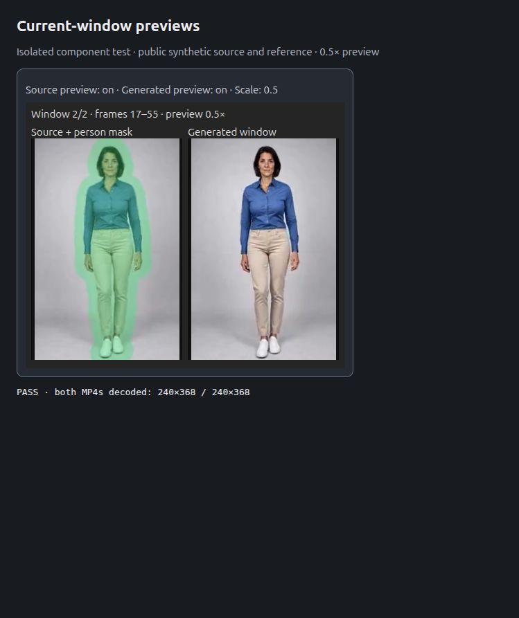

# ComfyUI H3 Texture Lab

[English](README.md) · [实验详记](docs/EXPERIMENTS.zh-CN.md)

主要用途是 **Character Swap：一段源视频＋一张人物参考图**。视频提供动作、姿态、场景；图片提供替换人物的身份、面孔和发型。

## 来源

本项目从 Akatz AI / Akatz Labs 的 **Character Swap V1.5 · H3 Relay 2.0** 工作流改造而来。人物替换 LoRA、训练和原始工作流属于原作者成果。

- [原始模型及工作流](https://huggingface.co/akatz-ai/MiniMax-H3-Character-Swap-LoRA)
- [原始 Relay V2 JSON](https://huggingface.co/akatz-ai/MiniMax-H3-Character-Swap-LoRA/blob/main/examples/H3-Character-Swap-Relay-V2.json)
- [H3 Relay](https://github.com/akatz-ai/h3-relay)
- [Motion Context](https://github.com/NikoDemon80/ComfyUI-H3-Motion-Context)：原生 latent 续接、Refine Blend、Join Match 来自此项目，本项目调用这些节点。

## 现在用哪个

导入 `examples/H3-TextureLab-CharacterSwap-480.json`，需要更大画面再使用 `H3-TextureLab-CharacterSwap-768.json`。这两份都是新建工作流，不覆盖已有工作流。可选自动清理使用新增的 `H3-TextureLab-CharacterSwap-480-CacheCleanup.json` 或 `...768-CacheCleanup.json`，开关默认关闭。安装 H3 Relay、Motion Context 和本节点包；将 `examples/inputs` 的测试图片和视频复制到 ComfyUI/input，或在工作流中选择自己的输入。模型另行下载。

它们保留源视频 SAM 人物遮罩和原音轨，使用原作者 **Character Swap V1.5＋FL2V Turbo 8-step**，强度均为 1，`er_sde / normal`，CFG 1。初始短测 56 帧、24fps，39 帧窗口、22 帧原生 latent 上下文，固定种子 194731。准备视频的时长改为 0 可处理完整输入，迭代次数从帧数自动计算。480/768 是原版像素预算预设，实际尺寸取决于输入。

FFN 分块设为 2048 以适配小显存，fused modulation 关闭。遮罩外保留源 latent；上下文节点保留原噪声遮罩。首帧不强制贴成参考肖像的构图。音轨使用源音频；全局 Join Match 关闭，避免改动受保护的背景。

## 磁盘／系统 RAM 缓存切换

在 **Store AV Latent · Disk / RAM** 节点中选择 **`cache_mode`**：

- **`disk`**：原有默认行为，每窗保存 AV safetensors 和 manifest，合成 MP4 也暂存磁盘。
- **`ram`**：把 AV latent 的独立副本保存在系统内存（CPU tensor），合成 MP4 和源音轨也直接编码到内存，不写 latent 文件、manifest、临时 WAV 或中间 MP4 缓存。最终保存的视频仍写入输出目录，采用临时交付文件加原子重命名。

直接使用新增的 `H3-TextureLab-CharacterSwap-480-RAM.json` 或 `...768-RAM.json`，也可在自己的工作流副本中将 Store 节点的 **`cache_mode` 设为 `ram`**。Finish Video 会自动识别。旧工作流仍默认 disk；不要在同一次任务中途切换模式。

RAM 模式下，最终保存节点的 `cleanup_cache=true` 会在成功保存并校验后释放本次持有的 RAM latent 和合成视频 buffer；关闭则在执行状态保留期间继续持有。不清理模型或其他任务，原生执行器仍可能独立缓存其他 tensor。

RAM 占用随窗口数增长。39帧窗口实测缓存数据约1.61MB（480×736）或4.00MB（768×1152）；40秒24fps、22帧重叠约90MB／224MB，**不包含**模型、源视频/遮罩、解码窗口、内存MP4和原生执行器缓存。ComfyUI退出、执行缓存被清空或主动释放后无法恢复。RAM 模式只避免本功能的中间缓存写盘；日志、内核缓存、系统 swap 仍可能写 SSD，不会修改系统 swap 设置。

## SSD 写入与缓存清理

**`disk` 模式以额外磁盘写入换取较低的内存占用。** 每个采样窗口（包括重叠上下文）都会以未压缩的 float32 视频/音频 safetensors 写入 `<输出目录>/H3-TextureLab-Cache/<run-id>/`。manifest 和合成视频也会产生写入，最终保存视频还可能再生成一份输出文件。因此，总写入量会超过最终压缩 MP4 的大小，并随分辨率、时长、重叠量和重复运行次数增加。

如果输出/缓存目录位于 SSD，这些写入会计入 SSD 写入负载并带来磨损。本项目尚未测量长期 SSD 寿命影响。请预留足够空闲空间，并在选择输出磁盘时考虑写入负载；磁盘速度也可能影响缓存和导出耗时。

**默认保留缓存。** 如需自动清理，使用新增的 `H3TextureSaveVideo`（Save Video & Optional Cache Cleanup）节点，连接 Finish Video 的视频输出与同一个 End Loop 的 state。新增示例 `H3-TextureLab-CharacterSwap-480-CacheCleanup.json` 和 `...768-CacheCleanup.json` 已接好；将 **`cleanup_cache`** 开关改成 **true** 才启用，默认 **false**。

该节点先将 MP4 保存到缓存目录之外，逐帧解码检查保存的视频和音频流，核对帧数、画布、帧率及音频流是否保留，成功后才删除本次完整任务中已识别的缓存文件。返回的视频指向最终保存文件，清理后仍能播放。保存/校验失败，或在清理前取消，均保留缓存；发现未知文件、符号链接或 manifest 不匹配时会跳过清理并在 report 中说明。不会清理其他任务目录或模型缓存。

请把它作为本次任务的最终保存节点。如果其他分支、续接、恢复或后续重导出仍需要这些 latent 或合成视频，请保持关闭；本保存节点成功不代表其他无关分支也成功。旧工作流不变，仍可继续使用标准 Save Video。示例保留原生 Start Loop，后续运行会建立新的缓存状态。

也可在确认最终视频已保存到缓存目录之外，且无运行中的任务需要这些文件后手动清理。清理只能释放空间，**不能撤销已经发生的 SSD 写入和磨损**。

## 实验范围

此前的静态、20 秒、40 秒和全身运动样片属于**单图 Ref2V 组件实验**，不能当作视频＋图片人物替换的质量验证。Character Swap 的独立端到端测试另行记录在实验文档中。

磁盘缓存能避免累计保存所有生成帧，也减少历史帧反复 VAE 解码/编码。它不能保证模型本身永不改变肤色、纹理或身份。最终仍按窗口解码，并非一次性把 40 秒画面全部装入显存。

单图实验使用 Ref2V Turbo，Character Swap 使用 FL2V Turbo，两者配方不同。`normal` 与 `simple` 的末尾 sigma 不同，refine 不能混为一谈。音频导出支持源音轨；暂不解码生成的音频 latent。

完整安装、参数和复现命令见 [English README](README.md)，实验过程、成功和失败结果见 [中文实验记录](docs/EXPERIMENTS.zh-CN.md)。代码 GPL-3.0-only；模型及上游代码保留各自许可。发布内容不包含私人原视频、私人工作流、用户拍摄的来源截图或模型权重。

## 零上下文独立窗口

在 **Window Plan** 将 **`context_frames` 设为 `0`**，各窗口独立生成。保留各自的源视频切片、遮罩和原始参考条件；跳过 Motion Context、上一窗口 latent 的读取和 Join Match。全部窗口仍进入选定的磁盘或 RAM 缓存，按顺序拼接，不丢弃重叠帧。已有工作流的上下文设置保持不变。

Character Swap 示例已经关闭 `first_frame_guide`。如果开启此可选开关，每个独立窗口都会在起始帧添加原始参考图锚点。零上下文可能减少上一窗错误的传递，但可能让姿态、纹理或颜色在接缝处跳变，**尚未证实能解决颜色漂移**。对于单图 Ref2V，如果每窗条件和固定种子完全相同，可能重复生成相同片段。CPU 测试验证了帧数及参考条件保留，尚未评估零上下文的 H3 生成画质。

## 单帧上下文

在 Window Plan 将 **`context_frames` 设为 `1`**，把上一窗口最后一张解码画面作为下一窗口第 0 帧的引导。每个接缝只裁掉 1 帧，源视频／遮罩切片对应重叠 1 帧，保留原始参考条件。磁盘和 RAM 缓存均支持，已有工作流的设置不变。

**此模式需要 VAE 解码／重编码。** 正常 H3 窗口的末尾 token 覆盖 4 帧，不能当作 1 帧 raw latent。该模式会解码上一窗口，再通过上游 Motion Context 只重编码最后一帧；无论 `context_source` 如何选择均如此。5/22/39/56 帧仍保留原来的 raw latent 路径。`carry_audio=true` 时，继续携带原有的 18 帧 raw 音频尾部，时间位置根据原始 AV 窗口计算。Character Swap 保持 `carry_audio=false`，继续使用源音频引导。

单帧可提供外观锚点，但运动信息少于较长上下文；仍可能出现动作接缝和 VAE 重建／偏色，尚未证实能解决颜色漂移。验证使用真实上游节点和 CPU 合成 VAE 数据，不代表 H3 画质测试。

## 流式源视频与当前窗口预览

使用新增的 **`H3-TextureLab-CharacterSwap-480-Streaming-RAM.json`** 或 **`...768-Streaming-RAM.json`**，旧工作流保持不变。原生 SAM3.1 multiplex 跟踪器只调用一次，保留连续跟踪状态。准备阶段只统计准确的24fps源帧数，不建立整段RGB张量；跟踪时最多缓存3帧原生像素平面。整片只保留每像素1bit的紧凑人物掩码，空帧恢复和欧氏膨胀逐帧处理。H3只读取当前窗口的图像、展开对应掩码，保持重叠和尾帧／音频补齐对齐。

FFmpeg完成解码和缩放后，通过FFV1无损管道交给PyAV，保留原版准备节点的浮点精度和色度转换，**不生成预处理视频缓存文件**。正常循环顺序只连续解码；如果回访已被缓存淘汰的早期窗口，会重新打开解码器并读取其前缀。读取／跟踪期间中断和最后窗口完成会关闭读取器；采样期间闲置的读取器会在其缓存状态释放时关闭；源文件在任务中途变化会报错。跟踪源帧不包含原版为H3网格预先补上的重复尾帧。

新增 **Current Window Previews · RAM** 在循环内部显示两种预览：**源视频＋人物遮罩**、**当前生成结果**。默认宽、高各为 **0.5倍**，只展示本窗新增帧，不重复展示上下文。预览编码成内存MP4，通过支持HTTP Range的接口播放；全局只保留最新窗口，压缩数据上限64MiB，不额外保存中间MP4。**生成预览仍需先对当前完整分辨率latent做一次VAE解码，再缩小**，可独立关闭以节省这次解码。正式分辨率和保存的latent不变；换到下一窗或服务退出后，旧预览链接失效。

限制：当前流式读取针对Linux/POSIX，要求FFmpeg/FFprobe和普通未裁剪、未设置时间截取的文件型 **Load Video**。前缀截取请用准备节点的 `duration_seconds`；其他裁剪／截取或内存VIDEO包装会明确拒绝，不会悄悄忽略。源音频仍以CPU波形保留，bit-packed掩码随时长增加；当前窗口RGB／MASK、模型和执行器缓存仍占RAM，因此这不是总内存硬上限。检测／跟踪仍在GPU，解码、打包和膨胀在CPU。另：已初始化单人物且 `max_objects=1` 满额时，当前跟踪器本来就跳过新目标检测，所以增大 `detect_interval` 不一定能加速。

验证记录：[CPU对齐](results/streaming-cpu-validation.json)、[真实SAM3 GPU和短片人物替换](results/streaming-gpu-validation.json)、[半分辨率预览播放](results/streaming-preview-validation.json)。截图为真实预览组件的隔离测试页面，并非完整ComfyUI画布。

开启 **Join Match** 的工作流请用 **H3TextureStoredWindowPreview**，放在 Store AV Latent 后，把它返回的 state 连接到 End Loop 的两个状态输入。预览读取实际缓存的修正后 video latent，原 state 保持不变。流式示例已改用这一顺序，旧的采样 latent 预览节点仍保留兼容。
