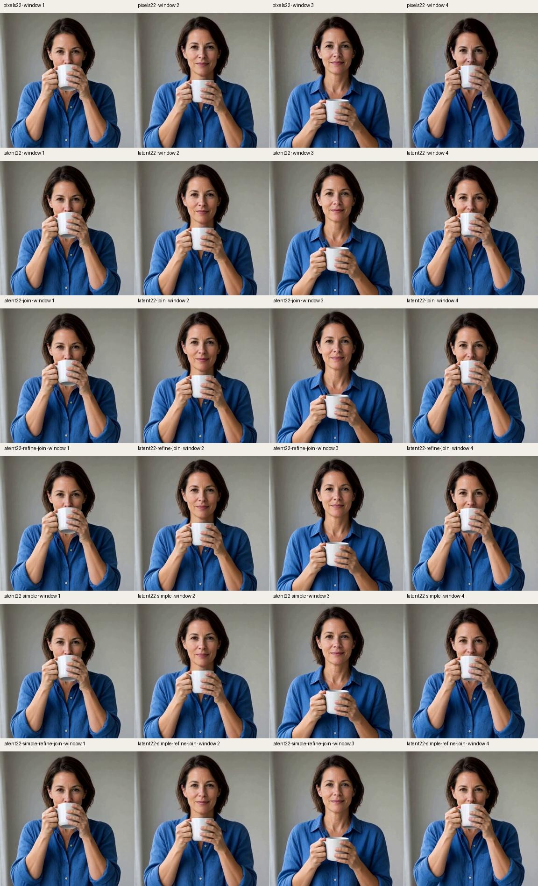
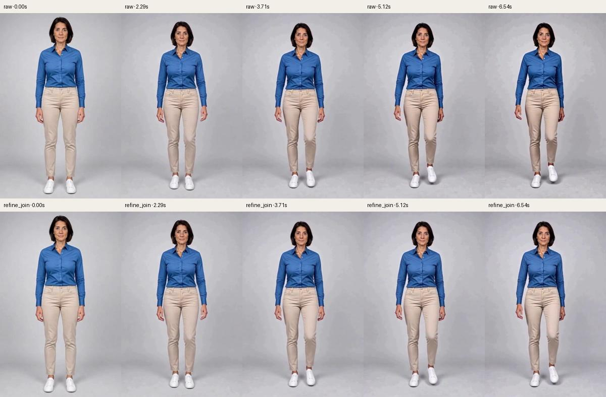
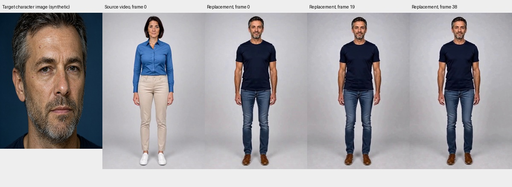
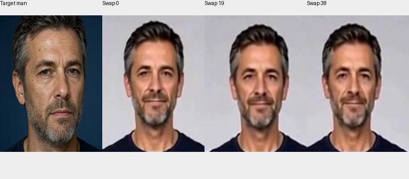
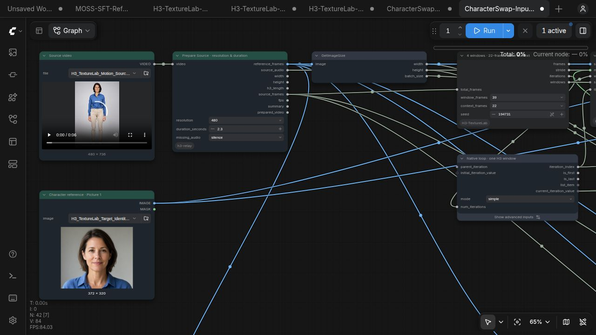

# Experiment record

[中文](EXPERIMENTS.zh-CN.md) · [README](../README.md)

## Scope and provenance

The application is **Character Swap: one source video plus one character image**. The origin is Akatz AI / Akatz Labs, [Character Swap V1.5 / H3 Relay V2](https://huggingface.co/akatz-ai/MiniMax-H3-Character-Swap-LoRA/blob/main/examples/H3-Character-Swap-Relay-V2.json). SAM selection, source preparation, the edit-mask adapter and the original two-LoRA recipe are upstream work. Native latent context, Join Match and Refine Blend are from [H3 Motion Context](https://github.com/NikoDemon80/ComfyUI-H3-Motion-Context), investigated at commit `518c083d11d80fa5920222ad89889924ee4401c9`.

The new work is disk state, bounded final decoding, source-aligned window adapters, optional native weight offload, FFN experiments, workflow integration and measurements. H3 Relay's existing sampling workspace wrapper is not claimed as a new invention. No existing user workflow is included in this release.

The experiments below are deliberately separated. **Single-image Ref2V experiments diagnose continuation and color behavior; they do not establish video-driven character replacement accuracy.** Character Swap runs use FL2V Turbo and the Character Swap adapter, rather than the Ref2V Turbo adapter used in the component tests.

## Environment and definitions

Observed environment: Ubuntu/Linux, ComfyUI 0.42.0, Python 3.12.11, Torch 2.15.0+cu132, native H3, SageAttention. The Character Swap examples explicitly select the accelerated Comfy Kitchen INT8 attention backend, matching the public upstream example; the single-image component driver uses the global SageAttention path. Main GPU RTX 3070 Ti 8GB; early small checks RTX A2000 Laptop 8GB. Models are INT8 convrot H3 diffusion and video VAE, Qwen3VL 32B NVFP4 AWQ text encoder. Character Swap additionally loads its V1.5 adapter, FL2V Turbo 8-step v1.0 and FP32 audio VAE. No weights are distributed.

`peak_allocated_mib` means **PyTorch allocated memory**, not total board memory. CUDA context, allocator reservations and other processes are excluded. The 768 motion NVML trace started after the first window and includes other resident applications: it is not a complete-process maximum. Timings are wall time with CPU weight transfer and native offload included unless explicitly marked microbenchmark. Cold model preparation and shared first-window reuse prevent naive total-time speed comparisons.

References and source clips in this repository are synthetic, fully clothed adults. The example portrait is a crop of a generated Qwen portrait. The motion source is a separately generated full-body H3 clip. The 480 source is a technical resize to the model's aligned 480×736 canvas. These are convenience fixtures, not a population-level evaluation set.

## 1. Why disk windows

The previous frame accumulation path retained cumulative RGB prefixes across loop outputs. Retained prefixes can grow quadratically in window count. For a synthetic 960-frame 768×768 stream, the projected retained-prefix footprint was about **67.9 GiB**, whereas a single full raw RGB sequence was about 6.3GB. The observed synthetic streaming export stayed near 1024MiB process RSS. This is an export/storage test, not an H3 inference benchmark.

Sixteen overlap/history checks covered 0, 1, 18 and 35 frames. A real A2000 test sampled two 22-frame 256×256 windows and delivered 43 frames, approximately 3970MiB peak device use. Deferred native VAE decoding matched immediate decoding exactly in that check. The saved video latents occupied 344,320 bytes versus 33,816,576 bytes of decoded RGB tensors. Native loop/toolkit contract tests passed.

The current pack saves full native video/audio tensors as float32 safetensors, atomically publishes a manifest, and keeps descriptors rather than decoded generated frames in loop state. Final export decodes one window at a time and trims its overlapping head. A yielded RGB frame owns its storage rather than retaining the decoded batch. Original **source-video** frames and masks are still prepared by H3 Relay in memory; this does not make arbitrarily long source decoding bounded.

The file cache is retained on disk. Removing model weights or this installation still breaks future rendering. Disk manifests are not automatic GUI crash recovery; the Python component benchmark has an explicit resume path.

## 2. Global color correction: useful, insufficient

A generated portrait with a neutral studio background was used for a 480×480, 480-frame / 20s run: 56-frame windows, one-frame feedback, 8 steps, CFG1, `er_sde / normal`, seed28461. Sampling took about396s; peak device use was6176.5MiB in the earlier recording.

Re-exporting the **same sampled latents** with limited neutral-background chroma correction reduced background chroma MAE from .009221 to .004078 (55.8%). Mean boundary RGB jump fell from .01184 to .000215. This is a paired export comparison, not a new generation comparison and not a texture score.

A separate correction-in-feedback run reached .004033 background chroma MAE (.004242 in its last second). It follows a different motion trajectory and cannot be treated as the same-latent control.

An actual **40s / 960-frame / 768×768** run completed 18 windows and final streaming decode without OOM. Sampling summed to1557.9s, PyTorch allocation peak3187MiB. Background chroma MAE was .004477 overall, first second .00342 and last second .00443. There was no paired uncorrected 768 run. Later frames still developed visible blotchy background texture: **hue correction did not solve spatial drift**. This long run used the earlier pixel-history/color-feedback recipe, not the new native-context Character Swap workflow.

## 3. Native latent context versus re-encoding

Motivation: avoid repeatedly decoding and encoding generated history, retain the original identity reference, and respect H3's temporal phase. The upstream context contract permits 5,22,39,56 frames. For a56-frame sample, a22-frame tail corresponds to seven video latent steps beginning at step10. A last latent step is not interchangeable with a requested single frame.

Six static recipes generated158 frames, four56-frame windows,22-frame overlap,480×480, seed28461, CFG1,8-step Ref2V Turbo. They share the **same first sampled AV window**, originally sampled with `normal`. Subsequent `simple` branches therefore compare continuation behavior from that shared first clip; they are not fully independent end-to-end simple-schedule runs.

The `pixels22` control keeps the same audio context and replaces only video context with VAE-reencoded decoded tail frames. The raw branch loads exact saved video/audio tensors. A sentinel-VAE contract check confirmed zero history encoding calls on raw continuation.

| Recipe | Final-window background blotch RMS | Highpass RMS | Chroma MAE |
|---|---:|---:|---:|
| Video history re-encoded, normal | .01915 | .00474 | .00949 |
| Raw latent22, normal | .01727 | .00552 | .00695 |
| Raw + Join Match, normal | .01778 | .00459 | .00698 |
| Raw + refine + join, normal | .01752 | .00497 | .00679 |
| Raw latent22, simple | .01833 | .00489 | .00653 |
| Raw + refine + join, simple | .01551 | .00372 | .00644 |

The background mask is fixed, neutral, eroded and about37.9% of the canvas. Blotch RMS compares Gaussian-lowpass residuals against the reference after removing global mean brightness. Highpass RMS measures fine variation, which can be unwanted grain **or wanted detail**. A lower score may mean blur. There is one static reference and seed: no identity, anatomy, face-recognition or human preference score is established.

The combined simple branch lowered this particular blotch score by about19% versus the re-encoded normal control, with both schedule and correction changed. That percentage is **not an isolated causal effect of raw context**. Raw-normal versus reencoded-normal is the appropriate aligned ablation.

Refinement uses the schedule's final interval, a separate seed28462, plain reference conditioning, pinned head22 and blend5. `normal` ended .125984→0; `simple` ended around.633672→0. Their refine passes have very different strength. Refine and Join Match can reduce artifacts in these samples, but cannot prevent model re-synthesis drift universally.



## 4. Full-body movement component tests

These tests use **one image**, not a source video. The prompt requests an adult woman walking in place, alternating steps, arm swing and slight torso rotation, fixed full-body camera. Actual results show stepping; arm swing is more limited than requested. They test temporal movement and texture behavior, not reference-motion accuracy.

Both resolutions use four56-frame windows,22-frame context,158 delivered frames /6.583s, seed41729, `er_sde/simple`, CFG1, Ref2V Turbo8. A second seed41730 is used for one-step refine. Native weight offload is enabled. FFN chunks and fused modulation are off.

At480×736 both raw and refine+join completed. Raw summed window time284.6s includes first-window63.86s; refine+join244.8s **reuses that first window**. Comparing continuation only is roughly220s raw versus245s refined: about11% additional continuation work, not an overall speedup. Recorded sampling allocation peaks were2812MiB raw and3186MiB refined; export peaked3541MiB. Visual inspection suggested a harsher/older-looking face late in raw versus somewhat cleaner refined output; this is an unblinded observation, not a validated identity score.

At768×1152 refine+join completed all158frames. Sampling times by window were136.3,174.6,174.4,174.3s. The NVML monitoring coverage limitation is described above. Both runs retain source-code hashes from startup; later planner extraction, fixed-seed schema metadata and Character Swap additions do not retroactively identify the exact tested source as the final release.



[480 component video](media/motion-480-refine.mp4) · [768 component video](media/motion-768-refine.mp4)

## 5. Character Swap integration

The new workflows take **one video + one image**, select and track the source actor with upstream SAM3, preserve source-aligned edit masks, condition on the current source video window and character image, and carry raw generated video context between windows. The sampler receives the **source latent and its native noise mask**. The portrait is not used as a forced first-frame composition. Source audio is guided separately, and the original waveform is muxed into final output.

Recipe: Character Swap V1.5 + FL2V Turbo8 v1.0, both1.0, native shift, `er_sde/normal`, CFG1, fixed seed194731,39-frame windows,22-frame context. Initial short fixture56frames /2.333s. FFN chunks2048, fused modulation off. Full source duration is selected by setting Prepare Source duration to0.

**Global Join Match is disabled**: it would change latent background outside the source edit mask. Results from the Ref2V recipe do not justify enabling it globally for masked video replacement. Raw audio continuation is disabled in favor of original source-audio guiding. This preserves the intended input contract and avoids two competing audio histories.

The exact 480/768 Character Swap end-to-end status and outputs are recorded separately in `results/character-swap.json`. Short tests cannot establish40s identity stability or long-source RAM bounds. Failure cases are retained in that record rather than relabeled as quality wins.


| Character Swap run | Canvas | Frames / windows | Native execution | Outcome |
|---|---|---|---|---|
| Pixel-budget warm-up | 576×864 | 56 / 2 | 267.4s | Completed |
| Exact 480 fixture | 480×736 | 56 / 2 | 195.9s | Completed |
| Exact 768 fixture | 768×1152 | 56 / 2 | 435.5s | Completed |
| Distinct male identity control | 480×736 | 39 / 1 | 101.6s | Clearly different character visible |

All four executed through the actual native ComfyUI graph, including SAM, reference encoding, edit-mask sampling and audio-bearing final export. The source has no real soundtrack, so source-audio retention was exercised with upstream synthesized silence; real speech is not validated. 480/768 two-window traces reached about7640/7600MiB **total device use**, including other processes and allocator reservations; these are not minimum VRAM requirements. The 768 request waited about101s behind the identity control, excluded from its435.5s execution figure.

The first warm-up used the upstream `480` pixel-area budget on a larger input, producing576×864. Exact 480×736 was then tested with a separately resized fixture. This is retained as a resolution-preparation finding, not mislabeled as a480-pixel-short-edge result.

The distinct male reference visibly changes face, hair, beard and upper clothing while retaining the source's full-body action and scene. The more similar female reference is a harder identity-discrimination case; no face-recognition accuracy is claimed. The distinct-identity clip is only one window and therefore does not itself measure inter-window identity drift.







[480 two-window swap](media/character-swap-480.mp4) · [768 two-window swap](media/character-swap-768.mp4) · [Distinct-identity control](media/character-swap-male-control.mp4)

## 6. FFN, modulation and transfer experiments

H3 hidden size5376, FFN intermediate14336, first projection28672×5376 and second5376×14336. Native SwiGLU/linear and modulation gates were already partly fused. Adding another generic fusion cannot remove all costs.

At12288tokens a2048-token FFN chunk reduced isolated extra allocation966→288MiB. A naive chunk repeatedly cast/copied CPU weights:173→536ms. Preparing both weights once through native cast contexts and using the native activation path recovered191→197ms with CPU weights,122→118ms with resident weights. No global weight cache was added.

Real A2000 22-frame480×480 tests: baseline118s, warm repeat107.63s, naive chunks159.83s, prepared chunks101.72s, fused modulation113.1s. The warm baseline was byte-identical to baseline. Chunk variants matched each other but differed from unchunked: videoPSNR38.36dB, latentRMSE.03097. Tiny-sequence overall allocation did not improve (1471→1497MiB).

A real768×768 first window measured98.86s /2811.8MiB baseline versus88.35s /2671.17MiB prepared chunks, saving140.63MiB overall. Other warm native windows were near85s. **No reliable end-to-end speedup is established.**

The tested fused RMS/adaptive-normalization kernel lacks H3's learned norm weight; folding it introduced about.33% relative RMS BF16 error. An isolated operation was about3× faster, without reliable full-run benefit. A first mixed-FP16 exploratory version produced NaNs and was invalidated; later tests used consistent BF16. FinalLayer was not patched. Fused modulation remains off by default.

PCIe256MiB synchronous transfers:3070Ti activePCIe3×16 pageableH2D31.717ms /8.46GB/s, pinned20.97ms /12.8GB/s; D2H32.9ms /8.15GB/s and pinned20.49ms /13.1GB/s. A2000 activePCIe3×4 pageableH2D93.9ms /2.86GB/s, pinned91.0ms /2.95GB/s. Small4KiB transfers were about12–21µs including synchronization. The3070's measured path was not unusually slow. These results do not show that transfer latency causes texture drift. No memory-pinning launch option was changed.

## Validation and remaining work

Unit fixtures cover window arithmetic, cropped tails, exact AV save/load, overlap trimming, cross-window history reads, owned RGB storage and path containment. Native API validation is separate from those stubs. Real GPU execution must also be distinguished from validation-only graphs. Existing workflow hashes are checked separately; all new examples have new names.

The most important remaining tests are longer **Character Swap** clips, fast motion, occlusions, multiple people, camera movement, difficult masks, identity changes viewed frame by frame, real source speech/audio and matched human ratings. More context can increase memory use, and correcting global statistics can erase legitimate lighting changes. This is an experimental toolkit, not a universal texture-stability guarantee.


## Optional cache cleanup — 2026-11-02

Added `H3TextureSaveVideo`, a terminal save/output node with `cleanup_cache=false` by default. The existing finish node and original workflows are unchanged. New `CharacterSwap-480-CacheCleanup` / `768-CacheCleanup` examples connect the finish video and the same End Loop state to the save node.

The node saves to a temporary MP4 outside the cache, fully decodes its video and audio, checks delivered frame count, dimensions, 24fps and audio-stream presence, then publishes the saved delivery before optional deletion. Cleanup accepts only this run's UUID directory directly under the configured cache root, a matching completed manifest and recognized regular files. Unknown files, links and mismatched manifests skip deletion. It does not purge model caches, scan old runs or certify unrelated branches; leave it off when the state is still needed elsewhere.

Validation: 18 unit tests passed, including default-off retention, successful per-run deletion, a neighboring run remaining intact, failed save, truncated video, lost audio, cancellation, an output inside the cache, mismatched source video, unknown files, symlinks, an unrelated directory and mismatched manifest. A native ComfyUI CPU fixture exercised actual Start/End Loop, AV disk storage, audio-bearing streaming export and the new save node. Three fresh requests through the same executor used cleanup off/on/on: each delivered a new 56-frame MP4 with decodable audio; only the off case retained its new cache. This is synthetic CPU export/cleanup validation, not a new H3 generation or quality benchmark.

Reproduce using ComfyUI's Python:

```sh
python -m unittest discover -s tests -v
python benchmarks/verify_cleanup.py --comfy-root /path/to/ComfyUI --output /path/to/cleanup-smoke
```

Machine-readable results: [cache-cleanup-validation.json](../results/cache-cleanup-validation.json). Cleanup reclaims space after writes have occurred; it does not reduce SSD write volume.


A subsequent **live local ComfyUI GPU acceptance run** used the actual Character Swap workflow at480×736, two39-frame windows with22-frame overlap,56 delivered frames,8 steps and cleanup enabled. Its inputs were the previously generated male portrait and synthetic-adult motion clip. The run completed in about220.3s including polling overhead. The run's manifest/cache was observed during generation and its directory was gone after save; all pre-existing run directories remained. The saved MP4 still decoded to56 frames with decodable audio after deletion. This qualifies the live save/cleanup path, not long-video identity quality. No new media files were added to the repository for this acceptance test.
