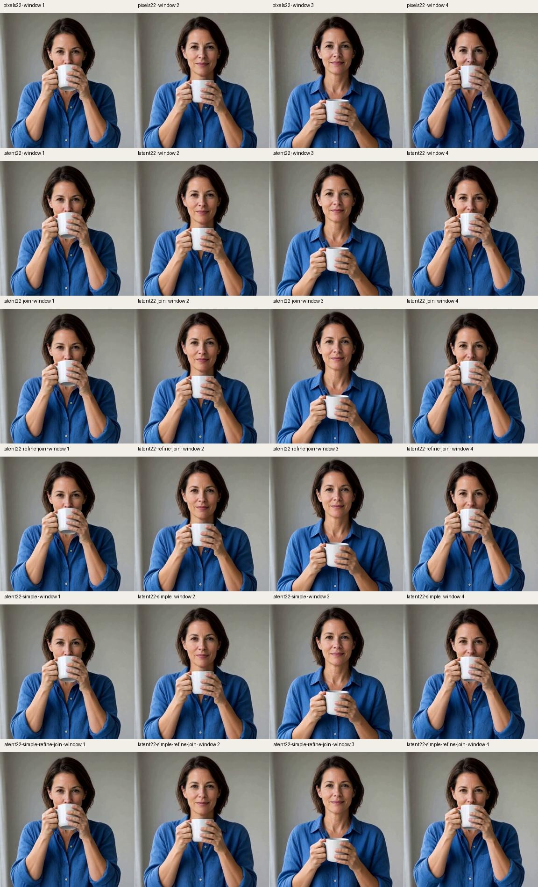
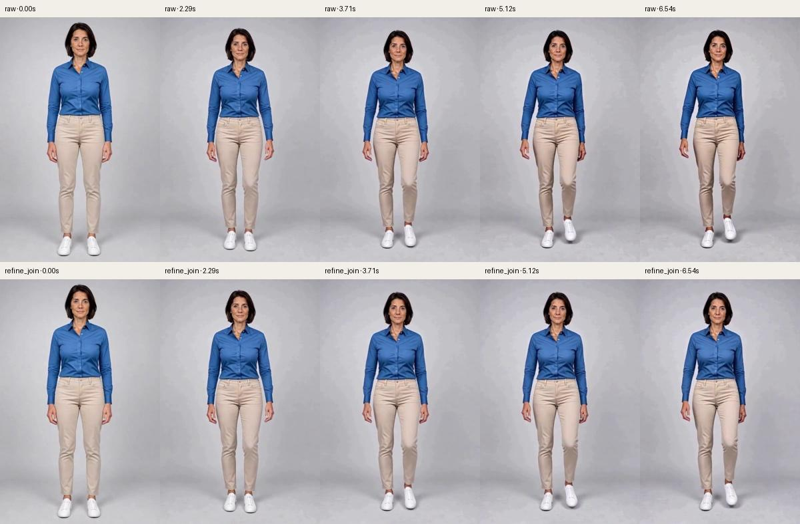
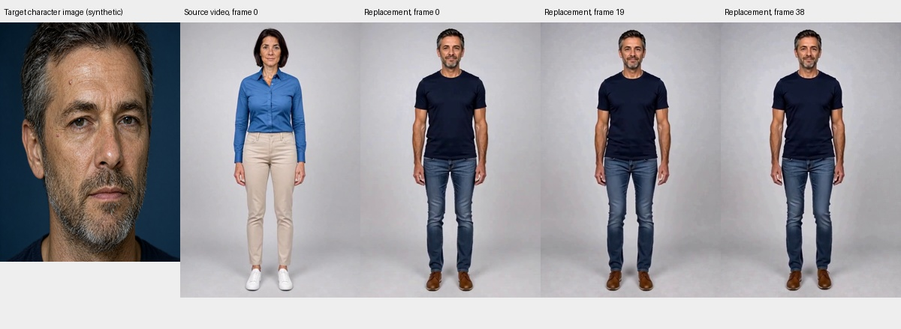
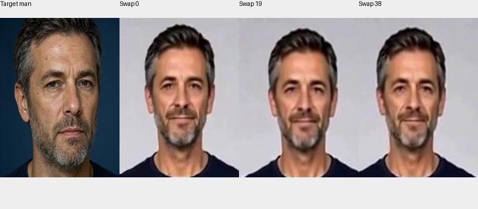
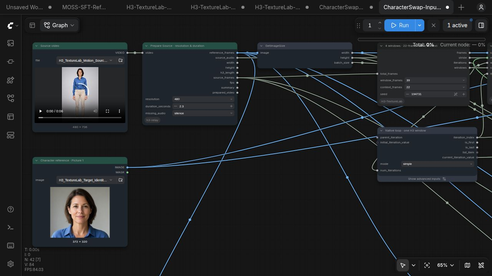

# 实验记录

[English 完整记录](EXPERIMENTS.md) · [项目说明](../README.zh-CN.md)

## 目标、来源与分组

目标是 **Character Swap：一段源视频＋一张人物图**。源视频提供动作、姿态、场景，人物图提供替换身份。源自 Akatz AI / Akatz Labs 的 [Character Swap V1.5 · H3 Relay 2.0](https://huggingface.co/akatz-ai/MiniMax-H3-Character-Swap-LoRA/blob/main/examples/H3-Character-Swap-Relay-V2.json)。SAM、源视频准备、原生编辑遮罩适配、人物替换 LoRA 和原始双 LoRA 配方属于上游成果。原生 latent 上下文、Refine Blend、Join Match 来自 [H3 Motion Context](https://github.com/NikoDemon80/ComfyUI-H3-Motion-Context)，研究版本为 `518c083d11d80fa5920222ad89889924ee4401c9`。

新增内容是磁盘状态、按窗口最终解码、源视频对齐适配、原生权重 offload 接入、FFN 实验与测量。H3 Relay 已有的采样 workspace 包装器不是本项目原创。发布不包含用户私人工作流、私人输入或来源手机照片。

**单图 Ref2V 组件实验与 Character Swap 验证分开记录。** 单图实验不能证明源视频动作还原或人物替换质量；两条流程使用的 Turbo LoRA 也不同。

## 环境与测量含义

Ubuntu/Linux，ComfyUI0.42.0，Python3.12.11，Torch2.15.0+cu132，原生H3＋SageAttention。主测3070Ti8GB，早期小测A2000Laptop8GB。INT8convrot主模型与视频VAE，Qwen3VL32BNVFP4AWQ文本编码器。Character Swap另用V1.5、FL2VTurbo8v1.0及FP32音频VAE。

PyTorch allocated peak不是整张显卡占用：不含CUDA上下文、保留池或其他应用。768运动测试NVML监控从首窗口之后才开始，不能当全程峰值。冷启动、首窗口共享和权重搬运会影响耗时，不能直接用两个总时间断言加速。

测试输入为生成的、穿着完整衣服的成年人。人物图来自Qwen生成肖像裁剪；视频来自另一段H3全身运动生成。480源视频是同一768素材技术缩放到480×736。这些是便于复现的少量样例，不能代表普遍人群表现。

## 磁盘窗口解决什么

旧累计RGB前缀在循环输出间被保留，可随窗口数出现平方级增长。960帧768²的合成测试中，累计前缀估算67.9GiB，单份原始RGB约6.3GB；流式导出进程RSS约1024MiB。这是存储/导出测试，不是H3推理显存测试。

16项历史/重叠检查覆盖0、1、18、35帧。A2000真实双窗口小测：每窗22帧256²，交付43帧，显卡峰值约3970MiB。该次延迟VAE解码与即时解码一致；latent344320字节，对应RGB张量33816576字节。

当前每窗保存原生视频/音频float32safetensors，原子更新manifest，循环仅保留描述符。最终按窗解码并裁掉重叠头；每个输出帧拥有自己的内存。**输入源视频和SAM遮罩仍由上游整段准备在内存中**，因此不是无限长源视频都能常数内存处理。

## 颜色纠正与40秒测试

20秒480²，480帧，56帧窗、1帧反馈、8步、CFG1、er_sde/normal、seed28461，采样约396秒。对**同一批latent**重导出：背景色度MAE .009221→.004078，下降55.8%；平均边界RGB跳变 .01184→.000215。这是颜色指标，不能当纹理或身份评分。

另一次把纠正结果反馈入历史的独立生成，色度MAE .004033，最后一秒 .004242。它的动作轨迹不同，不是同latent对照。

真实40秒768²，960帧、18窗，采样总1557.9秒、PyTorch allocated峰3187MiB，最终流式解码成功，无OOM。色度MAE总体 .004477，首秒 .00342，末秒 .00443。没有同分辨率未纠正配对组。后期仍有背景斑块：**稳住色相并未解决空间纹理漂移**。这次长测使用旧像素历史/颜色反馈配方，不等于新Character Swap方案已通过40秒验证。

## 原生latent与像素重编码对照

H3允许的上下文长度为5、22、39、56帧。56帧窗口内22帧尾部对应7个视频latent时间步，从第10步开始；不能拿“最后一个latent”当任意单帧。

六组静态测试：480²、158帧、4个56帧窗、22重叠、seed28461、8步Ref2VTurbo、CFG1。**共享同一个首窗口**，首窗用normal生成。simple组比较的是从相同首窗开始的续接，不是完整独立simple生成。

pixels22只将视频历史改成“解码尾部22帧再VAE编码”，音频历史保持相同。原生续接读出原始视频/音频张量，哨兵VAE检查确认没有调用历史重编码。

| 配方 | 末窗背景斑块RMS | 高频RMS | 色度MAE |
|---|---:|---:|---:|
| 重编码normal | .01915 | .00474 | .00949 |
| 原生latent22 normal | .01727 | .00552 | .00695 |
| 原生＋JoinMatch normal | .01778 | .00459 | .00698 |
| 原生＋refine＋join normal | .01752 | .00497 | .00679 |
| 原生latent22 simple | .01833 | .00489 | .00653 |
| 原生＋refine＋join simple | .01551 | .00372 | .00644 |

固定中性背景侵蚀遮罩约37.9%。斑块指标去掉全局亮度后比较高斯低通差；高频既可能是噪点也可能是真细节，降低也可能意味着变糊。没有身份、人脸识别、解剖或盲评指标。组合组相对重编码normal约低19%，同时改变了schedule与后处理，不能把19%全部归因于原生latent。

refine使用各自schedule最后一个区间，独立seed28462，原图条件，保护头22帧、混合5帧。normal末段约 .125984→0；simple约 .633672→0，强度明显不同，不能混称“一步纠正”。

## 全身运动组件测试

这部分仍是**单张图**驱动，提示原地行走、交替迈步、摆臂及轻微转身。实际有抬脚迈步，摆臂弱于提示。它衡量运动中的纹理表现，不衡量源视频动作还原。

480×736与768×1152，4窗、158帧、6.583秒、56窗/22上下文、seed41729、er_sde/simple、CFG1、Ref2VTurbo8。refine另用41730。开启原生权重offload，关闭FFN分块与fused。

480 raw总284.6秒，包含首窗63.86秒；refine+join总244.8秒但复用了首窗。只比续接约220秒对245秒，refine多约11%计算，不能说总时间更快。采样分配峰2812MiB与3186MiB，导出3541MiB。肉眼看raw后期面孔更粗糙/显老，refine较干净；这是非盲评主观观察，不是可靠身份结论。

768 refine+join全部完成，逐窗采样约136.3、174.6、174.4、174.3秒。保留启动时代码哈希；后续提取planner、固定种子schema及人物替换适配不应被倒称为当时完全相同源码。

## Character Swap适配

新建工作流使用上游SAM3检测与跟踪，按源视频时间切取图像、遮罩和音频；当前窗口视频与人物图共同编码。采样器接收**源latent及其noise_mask**，不会被普通空latent替换。首帧不强制贴成肖像构图；音频另用源波形指导并在最终视频中复用。

原作者双LoRA各1.0，er_sde/normal、CFG1、seed194731；39帧窗、22帧原生上下文，初测56帧/2.333秒。FFN2048，fused关闭。视频准备时长改0处理完整输入。480/768为上游像素预算预设，真实尺寸随输入变化。

**默认关闭全局JoinMatch**：它会改变遮罩外受保护的源背景，单图实验不能证明人物替换也适合全局统计匹配。原生音频历史关闭，以源音频指导为准。端到端测试状态、失败与输出另记 `results/character-swap.json`；短测不能证明40秒人物身份稳定，也不能证明任意长源视频不会占满CPU内存。

## Character Swap真实运行结果

| 测试 | 尺寸 | 帧数/窗口 | 原生执行时间 |
|---|---|---|---|
| 像素预算预热 | 576×864 | 56/2 | 267.4秒 |
| 精确480样例 | 480×736 | 56/2 | 195.9秒 |
| 精确768样例 | 768×1152 | 56/2 | 435.5秒 |
| 男性肖像明显身份对照 | 480×736 | 39/1 | 101.6秒 |

四次均通过真实ComfyUI原生图执行，包含SAM、双参考编码、遮罩采样与带音轨最终导出。源视频无真实声音，因此验证的是上游补静音音轨的保留路径，尚未验证真实对白。480/768监测约7640/7600MiB是**整卡占用**，包括其他进程与保留池，不是最低显存需求。768排在男性对照后等待约101秒，已从435.5秒执行时间中扣除。

第一次480预算预热实际得到576×864，故另测精确480×736，没有把预算标签误写成实际短边尺寸。

男性对照能明显看到脸、短发、胡须和上身衣服发生替换，保留源动作和场景。女性参考与源人物较相似，属于较难判断身份准确度的样例，不宣称人脸识别精度。男性对照只有一个窗口，也不证明跨窗身份稳定。

[480双窗口](media/character-swap-480.mp4) · [768双窗口](media/character-swap-768.mp4) · [男性身份短对照](media/character-swap-male-control.mp4)

## FFN、融合与PCIe

H3隐藏5376，FFN中间14336，两层投影28672×5376、5376×14336。原版SwiGLU/linear及gate已部分融合。

12288tokens微测，chunk2048将额外分配966→288MiB。朴素分块每块重复CPU权重转换/搬运，173→536毫秒；用原生cast上下文先准备两组权重后，CPU权重191→197毫秒，常驻权重122→118毫秒。没有全局模型缓存。

A2000真实22帧480²：baseline118秒、warm107.63、朴素159.83、改进101.72、fused113.1。重复baseline逐字节一致；分块两版彼此一致，但相对未分块视频PSNR38.36dB、latentRMSE .03097。小序列整体峰1471→1497MiB，并未省显存。

3070真实768²首窗：98.86秒/2811.8MiB→88.35秒/2671.17MiB，整体省140.63MiB；其他原生warm窗口约85秒，**不足以证明整段加速**。

融合RMS/adaptive-normalization核没有H3学习到的norm权重，折叠引入约0.33%相对RMS的BF16误差。孤立算子约快3倍，整段未证明收益。最早混FP16版本出现NaN，判为无效，后改一致BF16。未修改FinalLayer，fused默认关闭。

3070Ti实际PCIe3×16，256MiB：pageableH2D31.717ms/8.46GB/s，pinned20.97ms/12.8GB/s；D2H32.9ms/8.15GB/s、pinned20.49ms/13.1GB/s。A2000实际3×4，H2D93.9ms/2.86GB/s、pinned91ms/2.95GB/s。4KiB含同步12–21微秒。3070搬运不异常慢，纹理漂移也没有证据归因于搬运延迟。没有改启动的内存pinning选项。

## 验证与尚未证明的部分

单元测试覆盖帧数守恒、截尾、AV精确落盘、跨窗读取、输出帧内存独占和路径范围。合成单测、原生图验证、GPU真实执行分别记录。原工作流以哈希检查，新文件独立命名。

仍需较长Character Swap、多人物、遮挡、快运动、运动镜头、困难遮罩、真实对白音轨，以及逐帧身份检查与配对盲评。背景指标不是人像质量评分；全局纠正也可能误伤合理光照变化。本项目是实验工具，不承诺普遍消除纹理漂移。
